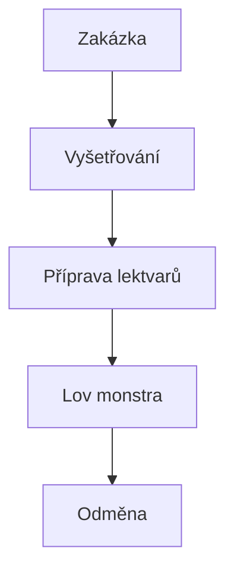

# master-of-markdown

# ⚔️ Geralt z Rivie
 
Profesionální lovec nestvůr známý ze série **Zaklínač** od Andrzeje Sapkowského.

 
*Pokud něco vrčí, kouše nebo chce zničit vesnici, Geralt má většinou řešení.*

 
~~A rozhodně není obyčejný člověk.~~
 

## 📖 Základní informace
 
Geralt z Rivie je zaklínač, který cestuje po Kontinentu a za odměnu likviduje nebezpečné nestvůry.

### 🎯 Schopnosti

 
- Šermířský boj
- Alchymie
- Zaklínačská znamení
- Stopování monster
- Vyjednávání se zákazníky
 

### ✅ Zaklínačův seznam úkolů

- [x] Porazit strigu

- [x] Najít Ciri

- [x] Porazit Divoký hon

- [ ] Dokončit všechny zakázky

- [ ] Získat legendární výbavu

 
## 🔗 Užitečné odkazy

 
- [Oficiální stránka Zaklínače](https://www.thewitcher.com)
- [Witcher Wiki](https://witcher.fandom.com/wiki/Geralt_of_Rivia)

 
## 🖼️ Podoba Geralta
 


 
## 💻 Jak by mohl Geralt počítat odměnu


```python

odmena_za_monstra = 300

pocet_zakazek = 4

celkem = odmena_za_monstra * pocet_zakazek

 
print(f"Geralt vydělal {celkem} orenů.")

```

 
## 📊 Přehled schopností

 
| Schopnost | Síla | Využití |

|------------|--------|---------|

| Meč | ⭐⭐⭐⭐⭐ | Boj |

| Znamení Igni | ⭐⭐⭐⭐ | Oheň |

| Alchymie | ⭐⭐⭐⭐ | Lektvary |

| Stopování | ⭐⭐⭐⭐⭐ | Hledání monster |

| Vyjednávání | ⭐⭐⭐ | Zakázky |

 

## 📐 Matematický zápis

 
```math

XP = Pocet\_monster \times Odmena

```


## 🔄 Geraltův pracovní postup

 




## 🏆 Zajímavost

 
Geralt používá dva meče:

 
1. Ocelový na lidi a běžná zvířata.

2. Stříbrný na většinu monster.

 
*Právě díky tomu patří mezi nejslavnější fantasy hrdiny vůbec.*
